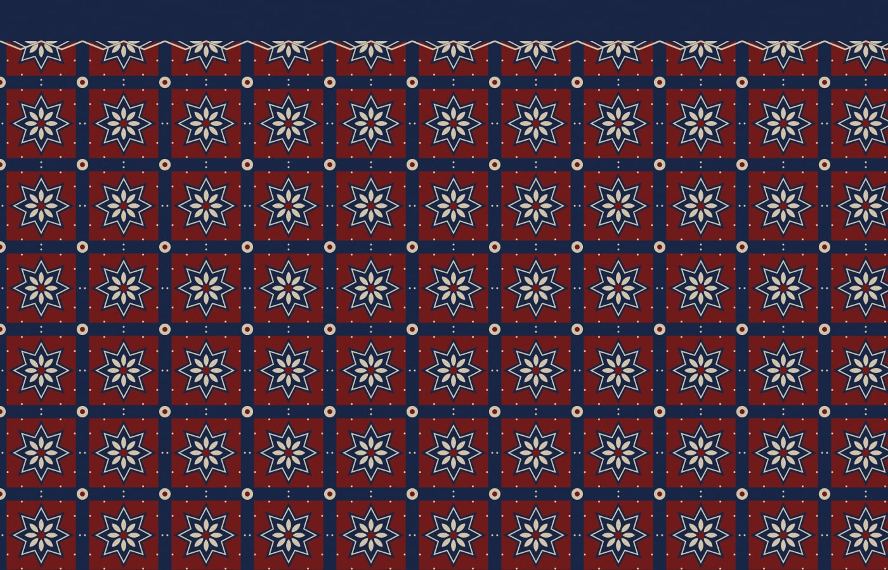
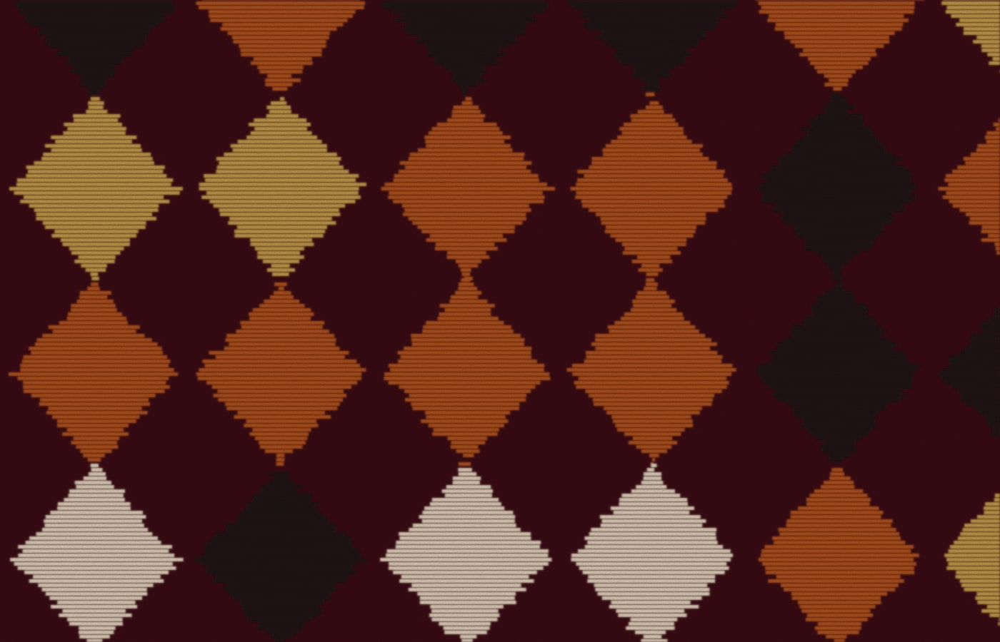
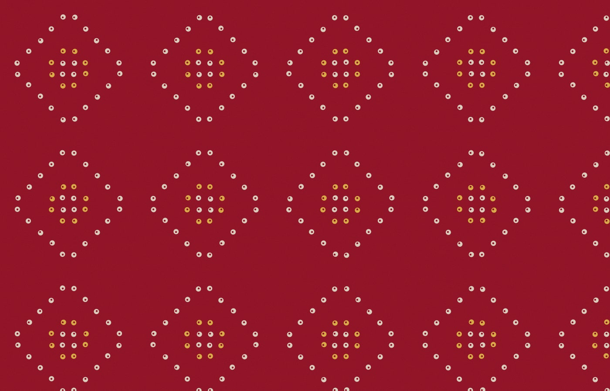

Every Indian textile tradition is, at heart, an algorithm. A carver cuts one block; a dyer ties one knot; a weaver resists one bundle of threads. Then the rule repeats — hundreds of times, thousands — until a single gesture becomes a surface you can wrap a body in.

This is a short field guide to three of those rules.

## Ajrakh: the grid that breathes

Ajrakh is a resist-printed cloth from the deserts of Sindh and Kutch, traditionally coloured with indigo and madder. Its signature is the star-in-a-square: a strict grid that somehow never feels rigid, because every cell contains a flower trying to escape it.

*Ajrakh-style repeat. Illustration drawn in code for this sample post.*

Look closely and you'll see the logic: a primary motif at the centre, a secondary motif at every corner, a border of dots to stitch them together. Three layers, one rule.

## Ikat: blur as a feature

Ikat flips the order of operations. Instead of printing on finished cloth, the threads themselves are tied and dyed *before* weaving. When the loom brings them together, the edges never quite align — and that soft, feathered blur becomes the whole point.

*Ikat-style diamonds: the jagged edges come from threads that land a few millimetres off. Illustration drawn in code.*

There's something quietly radical about a craft that refuses perfect registration. Precision would be easy; the makers chose imprecision on purpose.

## Bandhani: a pattern of points

Bandhani, from Gujarat and Rajasthan, works with the smallest unit possible: a dot. Thousands of tiny knots are tied into cloth before dyeing, and each one leaves a pale ring when untied. Arrange enough rings and you get diamonds, waves, even elephants.

*Bandhani-style dot diamonds. Illustration drawn in code.*

> A bandhani sari is a pointillist painting made by hand, one knot at a time.

## What the rules teach

Put the three side by side and a pattern of patterns appears. Ajrakh is about **structure**, ikat about **tolerance**, bandhani about **accumulation**. Between them they cover most of what a designer — or a programmer — needs to know about making something large out of something small.

*This is a sample post showing how images work. Replace it with your own, and drop real photographs into `src/assets/blog/`.*
