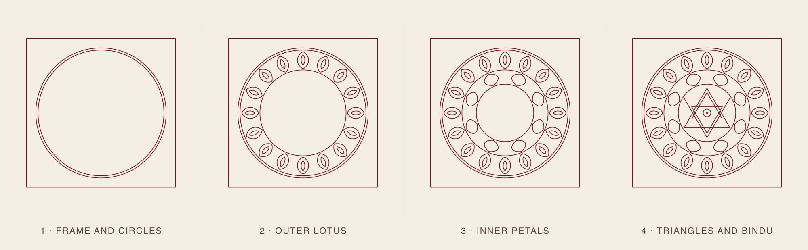

Open the front page of this journal and a yantra draws itself in gold: a square gateway, two rings of lotus petals, interlocking triangles, a single dot at the centre. None of it is an image file. It's about sixty lines of TypeScript generating SVG paths at build time.

## One petal, repeated

Everything starts with a single function that draws one petal pointing straight up — two Bézier curves meeting at a tip:

```ts
export function petal(r0: number, r1: number, w: number) {
  const h = r1 - r0;
  return `M0,${-r0} C${w / 2},${-(r0 + h * 0.25)} ${w / 2},${-(r0 + h * 0.75)} 0,${-r1}
          C${-w / 2},${-(r0 + h * 0.75)} ${-w / 2},${-(r0 + h * 0.25)} 0,${-r0}Z`;
}
```

Rotate it sixteen times around the centre and you have a lotus. Change three numbers and you have a different lotus.

## Building the yantra, layer by layer



*The four layers of the yantra. Each panel adds one ring of geometry.*

1. **Frame and circles** — a square gateway (the *bhupura*) and two concentric circles.
2. **Outer lotus** — sixteen petals, each with a smaller petal inside it.
3. **Inner petals** — eight broader petals, offset by half a step.
4. **Triangles and bindu** — interlocking triangles and the central dot.

## Drawing it in

Each path is given `pathLength="1"`, which lets CSS treat every line as exactly one unit long, whatever its real length. Animate `stroke-dashoffset` from 1 to 0 and the line appears to be drawn by an invisible pen. Stagger the delays and the whole figure blooms from the outside in.

## The jaali screen

Images and emblems on this site are revealed through a *jaali* — the pierced stone screens of Mughal and Rajput architecture. It's a single SVG laid over the picture: a rectangle the colour of the page, with eight-point stars cut out of it by a repeating pattern. Scaling one star inside that pattern scales every hole at once, so a few lines of JavaScript can open the whole screen as you scroll or hover until the stars overlap and the stone disappears.

## Why bother?

Because vector drawings stay sharp at any size, weigh almost nothing, adapt to dark mode with a single colour variable, and can move. A photograph of a yantra would be heavier, blurrier and frozen in place.

That said, a blog still needs photographs sometimes — which is why this post has a cover image and an inline figure. Both are optimised automatically at build time into modern formats and several sizes.

*This is a sample post showing how images work. Replace it with your own.*
