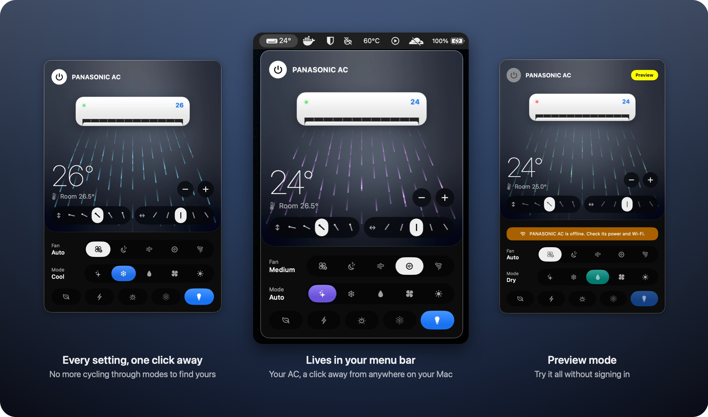
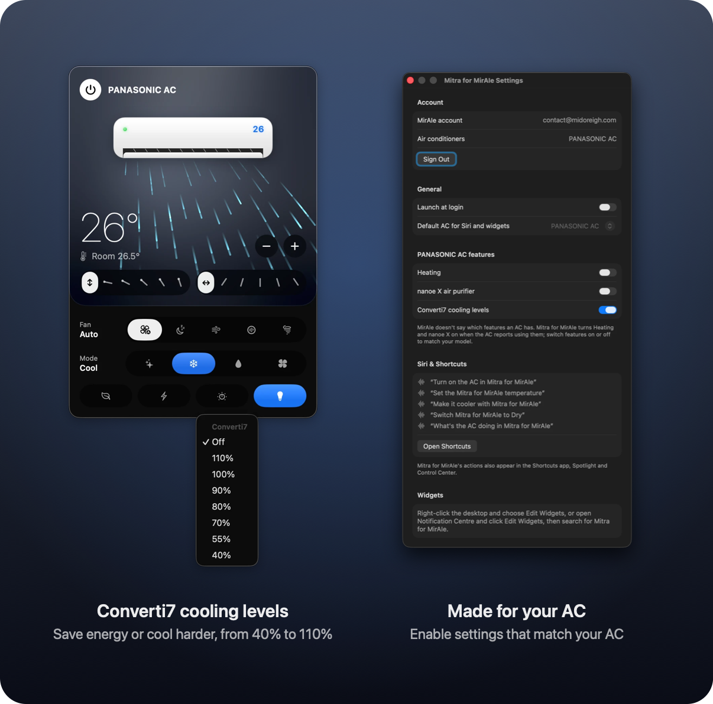
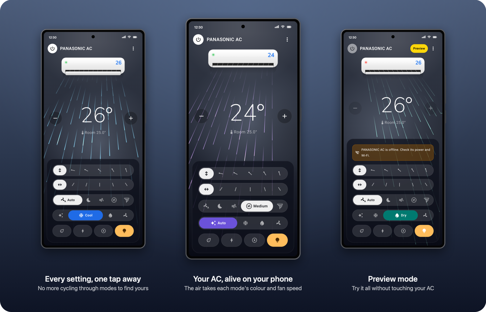

My Panasonic AC is a perfectly good machine with a slightly maddening remote. Want Dry mode? Press the mode button. Auto. Press again. Cool. Again. Dry, finally. Fan speed works the same way, and so does the air direction. The MirAIe app on my phone copies the remote faithfully, which is exactly the problem: the mode is a single button you tap over and over, stepping through every option until you land on the one you wanted.

So I built **Mitra for MirAIe**. *Mitra* means friend, and that's the job: a small app that sits in my Mac's menu bar and on my Android phone and puts every setting in front of me at once. Any mode, any fan speed, any louver position, one click or tap away.

*The Mac panel: every mode, fan speed and louver position laid out at once.*

## Lay it all out

The idea is simple: instead of a button that cycles, show the whole list. Auto, Cool, Dry and Fan (and Heat, on units that have it) sit side by side. Fan speed is Auto, Quiet, Low, Medium and High, named exactly as the MirAIe app names them. Both louvers get swing plus five fixed positions each. Temperature runs 16 to 30 °C with a plain minus and plus, and the room temperature the AC measures sits beside it.

Then there are the extras the remote hides behind long-presses: Eco, Powerful, the Converti7 cooling levels, nanoe X, and the display light, whose button now glows a warm, incandescent amber when it's on, like a lit bulb.

Mitra only shows what your unit actually has. Heat and nanoe X appear when the AC reports them, and you can switch individual features on or off for each AC in Settings, so the panel never offers a button that does nothing.

*Converti7 levels, and per-AC Settings for the features your unit really has.*

## Draw the air

The part I enjoyed most is the drawing. Mitra renders your unit and the air coming out of it the way it really behaves. The flap tilts to the louver position you picked. On swing, the air sweeps up and down and side to side at the unit's own pace. It takes on the colour of the mode, drifts lazily on Quiet and rushes on High. A small light on the drawn unit tells you whether the AC is online; when it isn't, the whole panel goes idle, shows its red light, and says what to check.

It turns a control panel into something closer to a window: a glance tells you what the AC is doing, not just what you last asked it to do.

## Always within reach

On the Mac, the set temperature sits right next to the menu bar icon. One click opens the panel. Siri works too ("Turn on the AC in Mitra for MirAIe") and every action is available in Shortcuts, so the AC can switch itself on before I get home.

On Android the AC fills the screen, with every control on a glass panel at the bottom, within thumb reach. There's a home-screen widget, a Quick Settings tile for power, and AC on, AC off, Cooler and Warmer when you long-press the app icon, so most days I never open the app at all.

*On Android, the same living AC with the controls under your thumb.*

And it stays honest. Change something with the remote or the MirAIe app and Mitra follows straight away. Commands update the panel instantly, and the AC's own status reports confirm them a second or two later.

## How it talks to the AC

MirAIe has no public API. Mitra does what the official app does: it signs in to your MirAIe account over REST, then sends commands and receives live status over MQTT. The Mac app is SwiftUI with a shared Swift package for the MirAIe client and the animated unit; the Android app is native Kotlin.

Your password never goes anywhere it shouldn't. On the Mac it lives in the Keychain; on Android it's encrypted with the Android Keystore. It's only ever sent to MirAIe's own servers. There are no analytics. Apart from MirAIe, the Mac app talks only to GitHub, to check for updates (you can turn that off), and the Android app talks to nothing else at all.

If you'd rather look around before handing over a login, choose **Try it without an account** for a demo AC, or switch on **Preview Mode** to try the controls without sending anything to your real unit.

## Free, open, and a little unsigned

Mitra is free and MIT-licensed, and the whole source is on GitHub. That freedom has one visible cost: the Mac app isn't signed with a paid Apple Developer ID. macOS will ask you to click **Open Anyway** in Privacy & Security when you first open it, and after each update it asks for your password once or twice before the new version can read the sign-in the old one saved in the Keychain. Choose **Always Allow** and it stays quiet until the next update. On Android, since it isn't on Google Play, you'll allow your browser to install the APK. Both prompts are expected; the code is there for anyone to read.

## Get it

- **Mac:** the [latest release](https://github.com/midoreigh/mitra-for-miraie/releases/latest), for macOS 26 or later on Apple silicon or Intel.
- **Android:** the [1.0.0 release candidate](https://github.com/midoreigh/mitra-for-miraie/releases/tag/android-v1.0.0-rc.1), for Android 8.0 or later.
- **Source, install guide and FAQ:** [github.com/midoreigh/mitra-for-miraie](https://github.com/midoreigh/mitra-for-miraie).

It works with Panasonic ACs you control through the MirAIe app. Mitra is an independent, unofficial project, not affiliated with or endorsed by Panasonic; MirAIe is Panasonic's trademark. If you try it, and especially if you try the Android release candidate, I'd love to hear what you think.
